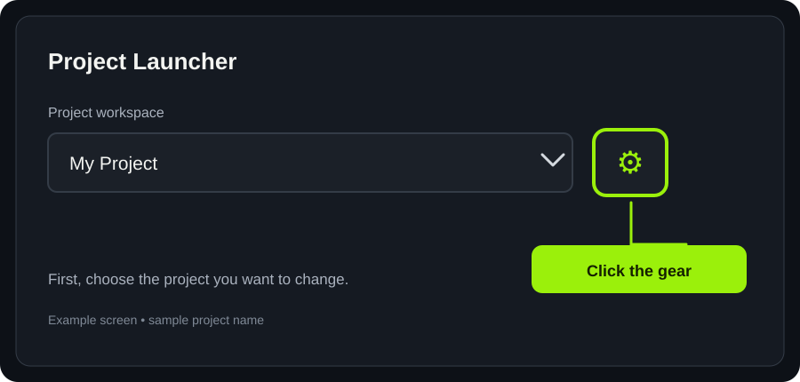
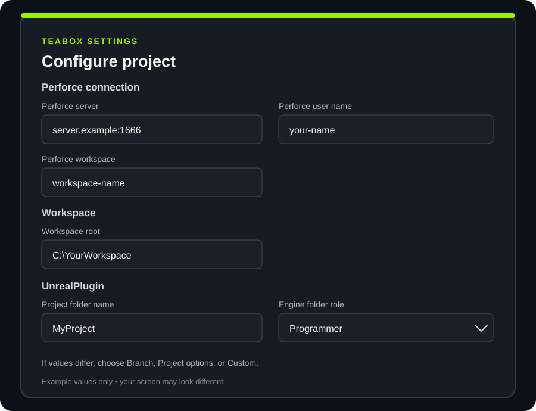
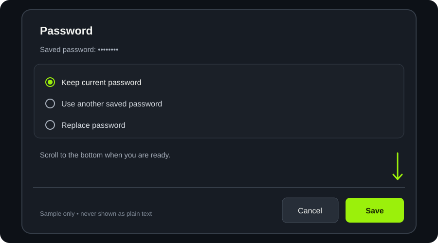
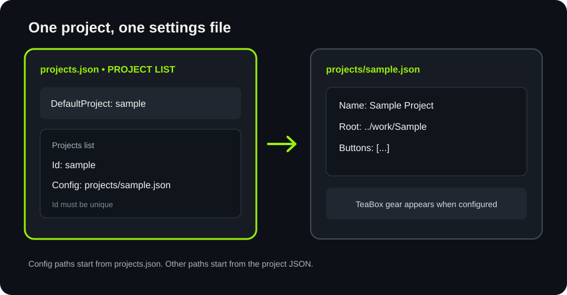
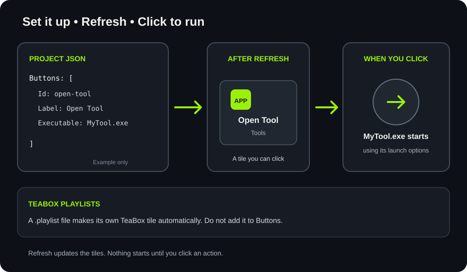

# Change TeaBox settings

Do this when you need to update a project's TeaBox details.

## 1. Pick your project

Choose the project from **Project workspace**, then click the gear beside it. These changes apply only to that project. If the gear is unavailable, ask your support person to check that project's setup.



## 2. Check the details

Check the connection, workspace, and project folder boxes. Pick an engine folder role. If choices appear under a box, pick the right value—or choose **Custom** and type it. If unsure, ask your support person.



## 3. Check the password and save

If **Keep current password** is offered, leave it selected. If saved passwords differ, choose the one that matches your project. If a saved password cannot be read, enter a replacement. Scroll down and click **Save**. If Save is unavailable, fill in the required boxes and resolve every choice. Click **Cancel** to leave without saving.



## Add or change a project

This part edits configuration files, not the gear dialog. Ask your support person where the synced config files are. Make a copy of the files before changing them. Keep the braces and commas; if you are unsure, stop and ask for help.

To add a project, first create its own JSON file, for example `projects/sample.json`:

```json
{
  "Name": "Sample Project",
  "Root": "../../work/Sample",
  "Buttons": []
}
```

`Root` points to the project's working folder, relative to this JSON file. Then add this entry inside the existing `Projects` list in `projects.json`:

```json
{
  "Id": "sample",
  "Config": "projects/sample.json"
}
```

Give each project a different `Id`. `Config` is a path from `projects.json` to the project's JSON file. To select the project when the launcher opens, set `DefaultProject` to its `Id`.

To change an existing project's name, folder, or buttons, follow its `Config` path and edit that project's JSON file. A project's gear is available only when its JSON has that project's TeaBox executable configured; ask support for the correct TeaBox paths when adding one. To change its TeaBox connection, workspace, or password, select that project and use its gear button above. Do not put passwords in JSON files.

After your usual config sync, click **Refresh** in the launcher. If it does not reload, close and reopen the launcher.



## Add or change an application button

Buttons are also in the project's JSON file. Put each button inside that file's `Buttons` list. This example opens a program inside the project folder:

```json
{
  "Id": "open-tool",
  "Label": "Open Tool",
  "Category": "Tools",
  "Executable": "{ProjectRoot}/Tools/MyTool.exe",
  "Arguments": [],
  "WorkingDirectory": "{ProjectRoot}"
}
```

Use a new `Id` for each button. `Label` is the words on the tile. `Executable` is the program file to open; only use a program you trust. `Category` groups related tiles. `Arguments` are extra startup values; leave `[]` if none are needed. `WorkingDirectory` is where the program starts; if omitted, the project folder is used. `Icon` is an optional picture for the tile. Without a category, buttons appear under **Applications**.

Save the JSON file and click **Refresh**. The tile appears in the selected project's actions. Clicking it opens the configured program; refreshing or opening the launcher does not run it. To change a button, edit its values. To remove it, remove its whole object from the `Buttons` list, keeping the remaining commas correct.



## TeaBox playlist buttons

Playlist tiles are made automatically. Put a `.playlist` file in the playlist folder already set for that project, then click **Refresh**. The filename (without `.playlist`) is the tile label; the project's configured prefix is added when it runs in TeaBox. Click its tile to run it. Do not add playlist tiles to the `Buttons` list.
